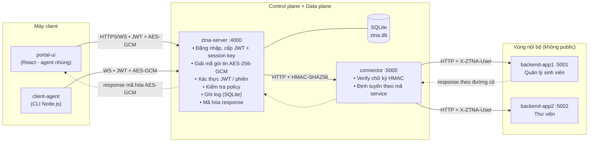

# Kiến trúc hệ thống ZTNA (PBL4)

## 1. Giới thiệu

Hệ thống mô phỏng mô hình **Zero Trust Network Access (ZTNA)**: mọi truy cập vào dịch vụ nội bộ đều phải đi qua một cổng trung tâm để **xác thực danh tính (JWT)**, **giải mã gói tin**, **kiểm tra quyền theo chính sách (policy)** và **ghi log đầy đủ** trước khi được chuyển tiếp vào trong. Các backend app **không bao giờ tiếp nhận request trực tiếp** từ client.

Nguyên tắc Zero Trust được áp dụng:

| Nguyên tắc | Hiện thực trong hệ thống |
|---|---|
| Never trust, always verify | Mọi gói tin đều kèm JWT, được verify chữ ký + hạn dùng + trạng thái phiên ở **mỗi lượt truy cập** |
| Mã hóa đường truyền ứng dụng | Payload bọc bằng **AES-256-GCM** với session key riêng cho từng phiên đăng nhập |
| Least privilege | Bảng `policies`: role `user` chỉ vào được `app2`, role `admin` vào được cả `app1`, `app2` |
| Micro-segmentation / ẩn dịch vụ | Backend app từ chối mọi request không đi qua connector (kiểm tra header `X-ZTNA-User`) |
| Kênh nội bộ có xác thực | ztna-server → connector ký **HMAC-SHA256** kèm timestamp chống replay/giả mạo |
| Giám sát tập trung | Mọi đăng nhập (đúng/sai) và mọi lượt truy cập (ALLOW/DENY) đều ghi vào SQLite |

## 2. Sơ đồ tổng thể



## 3. Thành phần

| # | Thành phần | Cổng | Vai trò |
|---|---|---|---|
| 1 | `ztna-server` | 4000 (HTTP + WS `/ws`) | Cổng ZTNA trung tâm: đăng nhập, cấp/kiểm tra JWT, giải mã – mã hóa gói tin, kiểm tra policy, ghi log, forward tới connector |
| 2 | `connector` | 5000 | Cửa hậu nội bộ: xác thực chữ ký HMAC từ ztna-server, ánh xạ `service → upstream` (`config.json`), chuyển tiếp request kèm định danh user |
| 3 | `portal-ui` | 5173 (Vite dev) | Giao diện web: đăng nhập, danh mục dịch vụ, gửi request qua kênh ZTNA, admin xem log. **Agent nhúng** trong `src/agent.js` thực hiện bọc gói tin |
| 4 | `client-agent` | — (CLI) | Agent dòng lệnh chạy tại client: đăng nhập, bọc JWT + mã hóa mọi lượt truy cập |

## 4. Control plane vs Data plane

- **Control plane** (trong `ztna-server`): đăng nhập, cấp phát JWT + session key, lưu trữ user/service/policy, thu thập log. Quyết định *“ai được làm gì”*.
- **Data plane** (`ztna-server` WS gateway + `connector`): vận chuyển gói tin đã bọc, giải mã/xác thực/định tuyến tới backend và đưa response quay về **đúng đường cũ**.

## 5. Trust boundary

```
[ Internet / Client ] ──(1)──> [ ztna-server ] ──(2)──> [ connector ] ──(3)──> [ backend apps ]
        Không tin cậy              Điểm kiểm soát           Vùng tin cậy nội bộ
```

1. Ranh giới (1): mọi dữ liệu từ client đều **không tin cậy** cho tới khi qua giải mã + xác thực tại ztna-server.
2. Ranh giới (2): chỉ request mang chữ ký HMAC hợp lệ từ ztna-server mới được connector chấp nhận.
3. Ranh giới (3): backend app chỉ chấp nhận request có header `X-ZTNA-User` do connector gắn (định danh đã xác thực).

## 6. Công nghệ

| Tầng | Công nghệ                                            |
|---|------------------------------------------------------|
| Backend services | Java Spring + WebSocket (`ws`) |
| Xác thực | JWT  + session lưu SQLite, mật khẩu băm bcrypt |
| Mã hóa gói tin | AES-256-GCM |
| Kênh nội bộ | HMAC-SHA256 + timestamp  |
| Database | SQLite (`better-sqlite3`) — xem `sql.md` |
| Frontend | React 18 + Vite |
