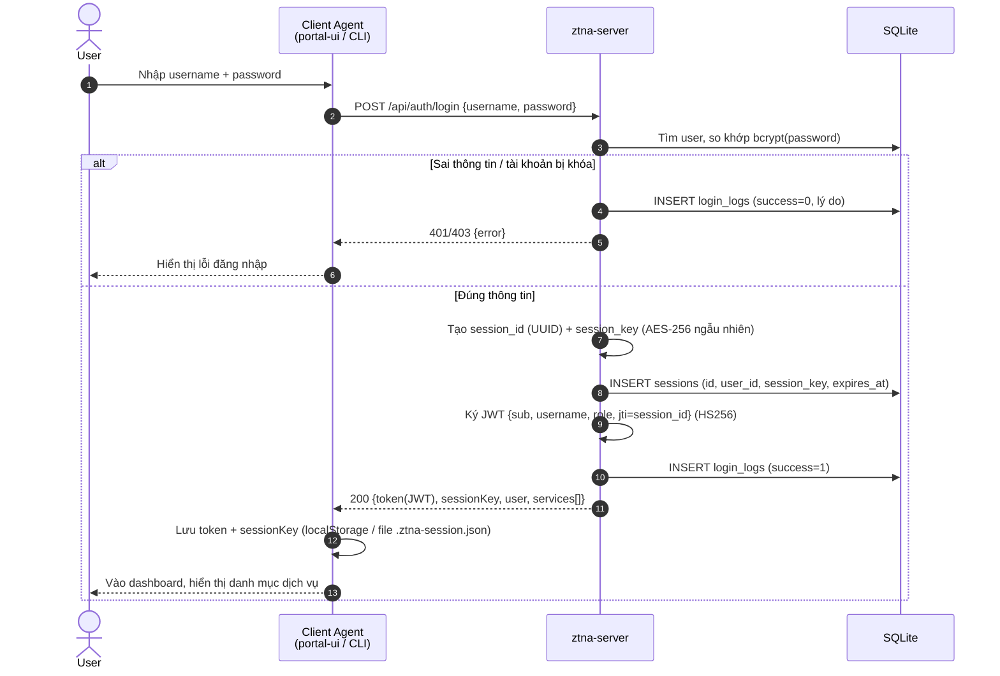
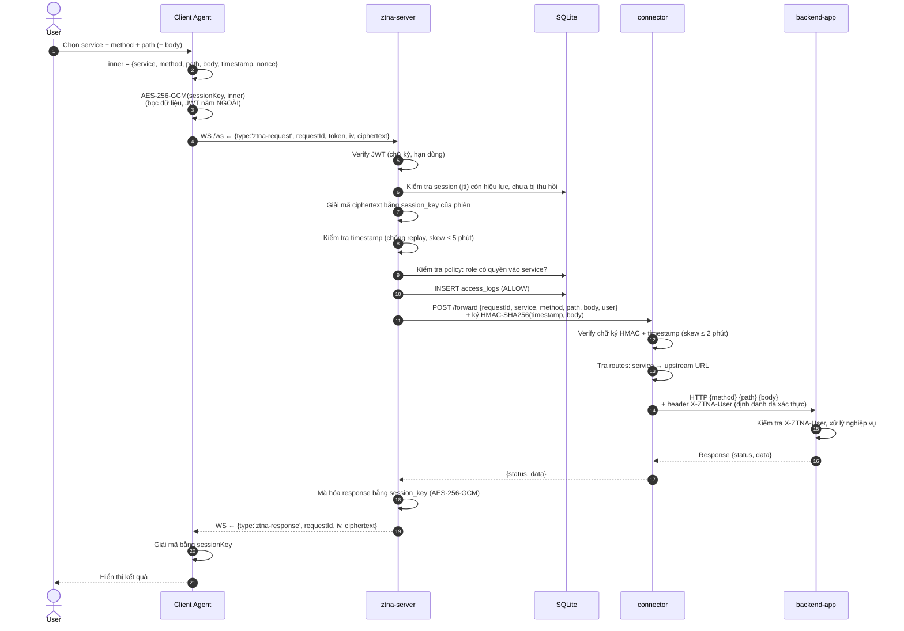
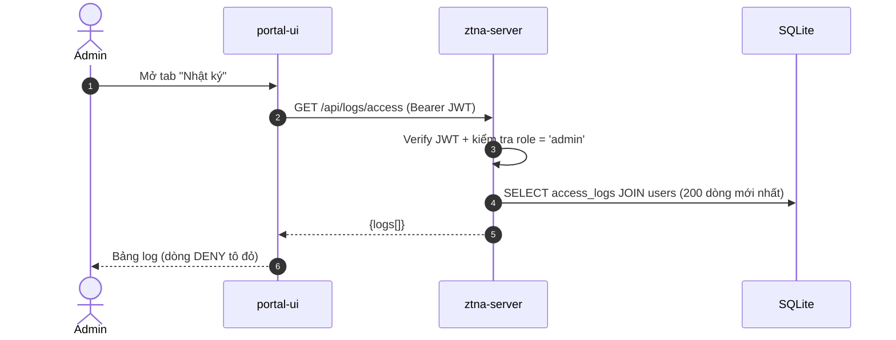

# Các luồng xử lý của hệ thống (Flows)

## 1. Luồng đăng nhập (cấp JWT + session key)



**Kết quả của bước đăng nhập:** client có 2 thứ — `token` (JWT, chứng minh danh tính cho *mỗi* gói tin) và `sessionKey` (khóa AES-256 dùng mã hóa *toàn bộ dữ liệu* của phiên).

## 2. Luồng truy cập dịch vụ (bọc gói tin → giải mã → xác thực → forward → response theo đường cũ)



## 3. Các luồng từ chối (DENY)

| # | Tình huống | Điểm chặn | Kết quả | Log |
|---|---|---|---|---|
| 1 | Sai username/password | ztna-server `/api/auth/login` | HTTP 401 | `login_logs(success=0)` |
| 2 | JWT giả mạo / hết hạn | WS gateway, bước verify JWT | `{type:'error', status:401}` | — (chưa giải mã được nên chưa có nội dung để log truy cập) |
| 3 | Session bị thu hồi / hết hạn | WS gateway, kiểm tra `sessions` | `{type:'error', status:401}` | — |
| 4 | Gói tin bị sửa đổi / sai session key | WS gateway, giải mã AES-GCM (auth tag lỗi) | HTTP 400 (bọc, mã hóa) | `access_logs(result='DENY', reason='Giải mã thất bại')` |
| 5 | Timestamp ngoài ngưỡng (replay) | WS gateway | HTTP 400 (bọc) | `access_logs(result='DENY', reason='Timestamp ngoài ngưỡng')` |
| 6 | Không có quyền vào service | WS gateway, kiểm tra `policies` | HTTP 403 (bọc) | `access_logs(result='DENY', reason='Không có quyền truy cập service')` |
| 7 | Gọi connector mà không có/sai chữ ký HMAC | connector `/forward` | HTTP 401 | log console của connector |
| 8 | Gọi thẳng backend app bỏ qua ZTNA | middleware của backend app | HTTP 403 | log console của app |

## 4. Luồng admin xem log



## 5. Định dạng gói tin tổng hợp

### Gói tin đi (client → ztna-server, qua WebSocket)

```json
{
  "type": "ztna-request",
  "requestId": "7a8f3a81-690a-4c54-bbf5-f72a7aa56017",
  "token": "<JWT HS256: {sub, username, role, jti}>",
  "iv": "WTJHhuoL583ET66e",
  "ciphertext": "<base64: AES-256-GCM(inner) + auth tag 16 byte nối cuối>"
}
```

### Nội dung bên trong (sau khi giải mã)

```json
{
  "service": "app1",
  "method": "GET",
  "path": "/api/students",
  "body": null,
  "timestamp": 1759576399000,
  "nonce": "a1b2c3d4"
}
```

### Gói tin về (ztna-server → client)

```json
{
  "type": "ztna-response",
  "requestId": "7a8f3a81-690a-4c54-bbf5-f72a7aa56017",
  "iv": "...",
  "ciphertext": "<base64: AES-256-GCM({status, data}) + tag>"
}
```

`requestId` (UUID) dùng ghép cặp request–response trên cùng một kết nối WebSocket, cho phép gửi nhiều request đồng thời.
