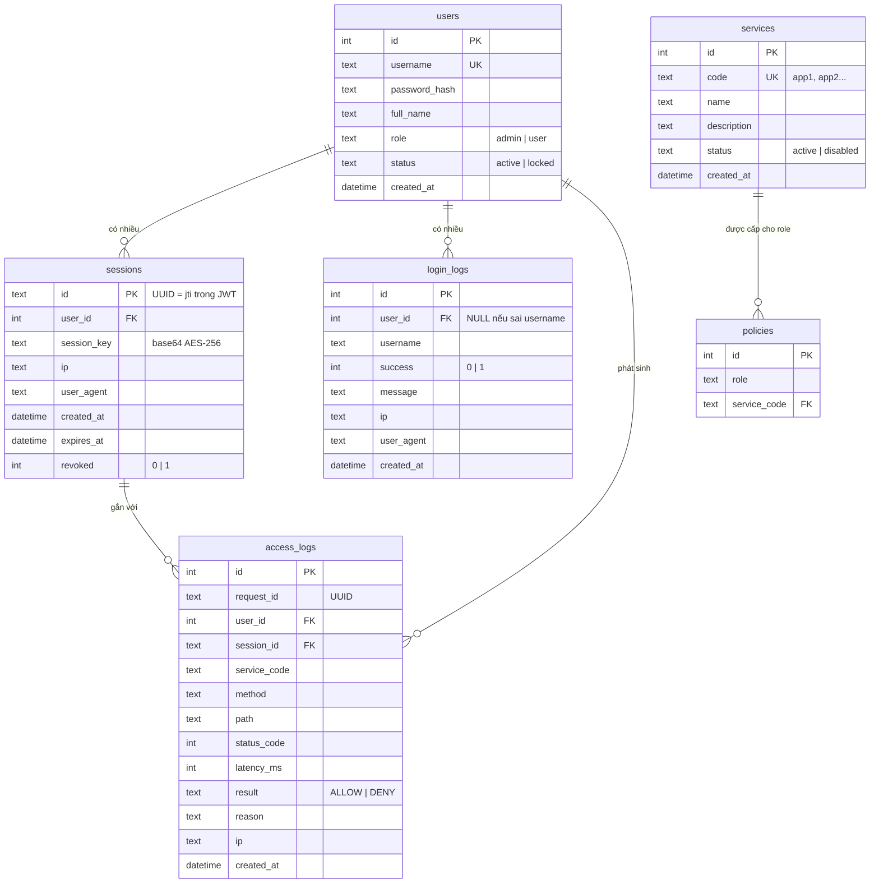

# Thiết kế cơ sở dữ liệu (sql.md)

Database của `ztna-server` — nơi lưu tài khoản, danh mục dịch vụ, chính sách truy cập, phiên đăng nhập và toàn bộ log. Bản demo chạy **SQLite** (file `ztna-server/db/ztna.db`, tự tạo + seed khi khởi động); cuối file có **DDL tương đương cho MySQL** nếu muốn chuyển.

## 1. Sơ đồ quan hệ (ERD)



## 2. DDL (SQLite — dùng trong code `ztna-server/src/db.js`)

```sql
CREATE TABLE IF NOT EXISTS users (
  id            INTEGER PRIMARY KEY AUTOINCREMENT,
  username      TEXT NOT NULL UNIQUE,
  password_hash TEXT NOT NULL,
  full_name     TEXT NOT NULL DEFAULT '',
  role          TEXT NOT NULL DEFAULT 'user'    CHECK (role IN ('admin','user')),
  status        TEXT NOT NULL DEFAULT 'active'  CHECK (status IN ('active','locked')),
  created_at    TEXT NOT NULL DEFAULT (datetime('now'))
);

CREATE TABLE IF NOT EXISTS services (
  id          INTEGER PRIMARY KEY AUTOINCREMENT,
  code        TEXT NOT NULL UNIQUE,
  name        TEXT NOT NULL,
  description TEXT NOT NULL DEFAULT '',
  status      TEXT NOT NULL DEFAULT 'active'  CHECK (status IN ('active','disabled')),
  created_at  TEXT NOT NULL DEFAULT (datetime('now'))
);

CREATE TABLE IF NOT EXISTS policies (
  id           INTEGER PRIMARY KEY AUTOINCREMENT,
  role         TEXT NOT NULL,
  service_code TEXT NOT NULL REFERENCES services(code),
  UNIQUE (role, service_code)
);

CREATE TABLE IF NOT EXISTS sessions (
  id          TEXT PRIMARY KEY,
  user_id     INTEGER NOT NULL REFERENCES users(id),
  session_key TEXT    NOT NULL,
  ip          TEXT,
  user_agent  TEXT,
  created_at  TEXT NOT NULL DEFAULT (datetime('now')),
  expires_at  TEXT NOT NULL,
  revoked     INTEGER NOT NULL DEFAULT 0
);

CREATE TABLE IF NOT EXISTS login_logs (
  id         INTEGER PRIMARY KEY AUTOINCREMENT,
  user_id    INTEGER,
  username   TEXT NOT NULL,
  success    INTEGER NOT NULL,
  message    TEXT,
  ip         TEXT,
  user_agent TEXT,
  created_at TEXT NOT NULL DEFAULT (datetime('now'))
);

CREATE TABLE IF NOT EXISTS access_logs (
  id           INTEGER PRIMARY KEY AUTOINCREMENT,
  request_id   TEXT,
  user_id      INTEGER,
  session_id   TEXT,
  service_code TEXT,
  method       TEXT,
  path         TEXT,
  status_code  INTEGER,
  latency_ms   INTEGER,
  result       TEXT NOT NULL CHECK (result IN ('ALLOW','DENY')),
  reason       TEXT,
  ip           TEXT,
  created_at   TEXT NOT NULL DEFAULT (datetime('now'))
);

CREATE INDEX IF NOT EXISTS idx_sessions_user     ON sessions(user_id);
CREATE INDEX IF NOT EXISTS idx_access_logs_time  ON access_logs(created_at);
CREATE INDEX IF NOT EXISTS idx_access_logs_user  ON access_logs(user_id);
CREATE INDEX IF NOT EXISTS idx_login_logs_time   ON login_logs(created_at);
```

## 3. Giải thích thiết kế

- **`sessions.id` chính là `jti` của JWT**: nhờ đó server kiểm tra được phiên còn sống không (revoke/hết hạn) chỉ với 1 truy vấn — khắc phục nhược điểm “JWT không thu hồi được”.
- **`sessions.session_key`**: khóa AES-256 của phiên, server dùng để giải mã/mã hóa gói tin; client nhận khóa này một lần lúc login.
- **`policies`** là bảng thuần `(role, service_code)`: thêm quyền = thêm 1 dòng, không cần sửa code.
- **`access_logs.result`** chỉ nhận `ALLOW`/`DENY` (CHECK constraint); với `DENY`, cột `reason` ghi lý do (sai quyền, timestamp lạ, giải mã lỗi...).
- **`login_logs`** ghi cả đăng nhập sai (`success=0`) phục vụ phát hiện dò mật khẩu.
- Không có FK cứng ở `access_logs.user_id/session_id` để log không bị mất khi user/session bị xóa (phục vụ audit).

## 4. Dữ liệu mẫu (seed tự động)

| users | password | role | services được cấp (policies) |
|---|---|---|---|
| `admin` | `admin123` | admin | `app1`, `app2` |
| `sv1` | `123456` | user | `app2` |
| `sv2` | `123456` | user | `app2` |

| services.code | name | description |
|---|---|---|
| `app1` | Quản lý sinh viên | API CRUD sinh viên (chỉ admin được ghi) |
| `app2` | Thư viện | API tra cứu / mượn sách |

> Mật khẩu lưu dạng `bcrypt` hash (`password_hash`), không lưu plaintext.

## 5. Truy vấn hữu ích cho báo cáo

```sql
-- Các lượt truy cập bị từ chối gần đây (phát hiện bất thường)
SELECT a.created_at, u.username, a.service_code, a.method, a.path, a.reason
FROM access_logs a LEFT JOIN users u ON u.id = a.user_id
WHERE a.result = 'DENY'
ORDER BY a.id DESC;

-- Top user truy cập nhiều nhất
SELECT u.username, COUNT(*) AS luot_truy_cap
FROM access_logs a JOIN users u ON u.id = a.user_id
GROUP BY u.username ORDER BY luot_truy_cap DESC;

-- Đăng nhập thất bại nhiều lần (nghi dò mật khẩu)
SELECT username, ip, COUNT(*) AS so_lan_fail
FROM login_logs
WHERE success = 0
GROUP BY username, ip
HAVING so_lan_fail >= 3;

-- Latency trung bình theo service
SELECT service_code, ROUND(AVG(latency_ms), 1) AS avg_ms, COUNT(*) AS requests
FROM access_logs
WHERE result = 'ALLOW'
GROUP BY service_code;

-- Phiên đang hoạt động
SELECT s.id, u.username, s.ip, s.created_at, s.expires_at
FROM sessions s JOIN users u ON u.id = s.user_id
WHERE s.revoked = 0 AND datetime('now') < s.expires_at;
```

## 6. DDL tương đương cho MySQL 8

Khác biệt chính: `AUTOINCREMENT → AUTO_INCREMENT`, `TEXT → VARCHAR/TEXT`, `datetime('now') → NOW()`/`CURRENT_TIMESTAMP`, CHECK constraint được MySQL 8 enforce, `revoked/success` dùng `TINYINT(1)`.

```sql
CREATE TABLE users (
  id            INT AUTO_INCREMENT PRIMARY KEY,
  username      VARCHAR(64)  NOT NULL UNIQUE,
  password_hash VARCHAR(255) NOT NULL,
  full_name     VARCHAR(255) NOT NULL DEFAULT '',
  role          VARCHAR(16)  NOT NULL DEFAULT 'user'   CHECK (role IN ('admin','user')),
  status        VARCHAR(16)  NOT NULL DEFAULT 'active' CHECK (status IN ('active','locked')),
  created_at    DATETIME     NOT NULL DEFAULT CURRENT_TIMESTAMP
) ENGINE=InnoDB DEFAULT CHARSET=utf8mb4;

CREATE TABLE services (
  id          INT AUTO_INCREMENT PRIMARY KEY,
  code        VARCHAR(32)  NOT NULL UNIQUE,
  name        VARCHAR(255) NOT NULL,
  description TEXT,
  status      VARCHAR(16)  NOT NULL DEFAULT 'active' CHECK (status IN ('active','disabled')),
  created_at  DATETIME     NOT NULL DEFAULT CURRENT_TIMESTAMP
) ENGINE=InnoDB DEFAULT CHARSET=utf8mb4;

CREATE TABLE policies (
  id           INT AUTO_INCREMENT PRIMARY KEY,
  role         VARCHAR(16) NOT NULL,
  service_code VARCHAR(32) NOT NULL,
  UNIQUE KEY uq_policy (role, service_code),
  FOREIGN KEY (service_code) REFERENCES services(code)
) ENGINE=InnoDB DEFAULT CHARSET=utf8mb4;

CREATE TABLE sessions (
  id          CHAR(36) PRIMARY KEY,               -- UUID = jti trong JWT
  user_id     INT NOT NULL,
  session_key VARCHAR(64) NOT NULL,               -- base64 của AES-256 key
  ip          VARCHAR(64),
  user_agent  VARCHAR(255),
  created_at  DATETIME NOT NULL DEFAULT CURRENT_TIMESTAMP,
  expires_at  DATETIME NOT NULL,
  revoked     TINYINT(1) NOT NULL DEFAULT 0,
  FOREIGN KEY (user_id) REFERENCES users(id),
  INDEX idx_sessions_user (user_id)
) ENGINE=InnoDB DEFAULT CHARSET=utf8mb4;

CREATE TABLE login_logs (
  id         BIGINT AUTO_INCREMENT PRIMARY KEY,
  user_id    INT NULL,
  username   VARCHAR(64) NOT NULL,
  success    TINYINT(1)  NOT NULL,
  message    VARCHAR(255),
  ip         VARCHAR(64),
  user_agent VARCHAR(255),
  created_at DATETIME NOT NULL DEFAULT CURRENT_TIMESTAMP,
  INDEX idx_login_logs_time (created_at)
) ENGINE=InnoDB DEFAULT CHARSET=utf8mb4;

CREATE TABLE access_logs (
  id           BIGINT AUTO_INCREMENT PRIMARY KEY,
  request_id   CHAR(36),
  user_id      INT,
  session_id   CHAR(36),
  service_code VARCHAR(32),
  method       VARCHAR(8),
  path         VARCHAR(255),
  status_code  INT,
  latency_ms   INT,
  result       VARCHAR(8) NOT NULL CHECK (result IN ('ALLOW','DENY')),
  reason       VARCHAR(255),
  ip           VARCHAR(64),
  created_at   DATETIME NOT NULL DEFAULT CURRENT_TIMESTAMP,
  INDEX idx_access_logs_time (created_at),
  INDEX idx_access_logs_user (user_id)
) ENGINE=InnoDB DEFAULT CHARSET=utf8mb4;
```
